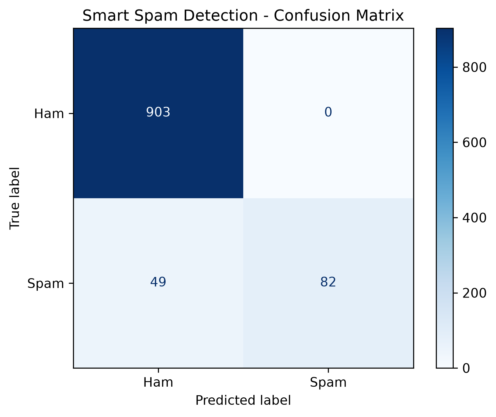
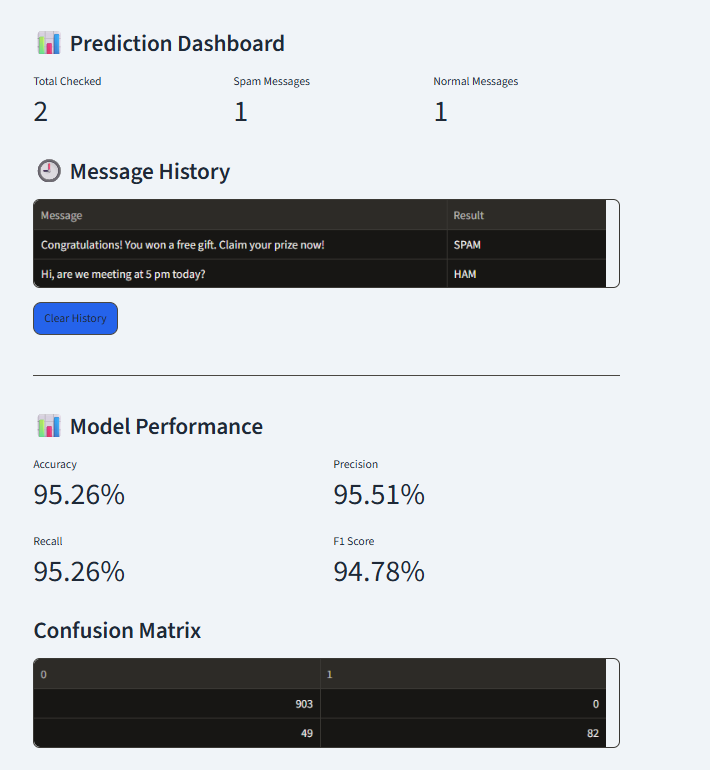

# Smart Spam Detection Using Machine Learning

A machine learning project that identifies unwanted SMS messages and classifies them as **Spam** or **Ham (Legitimate)** using Natural Language Processing (NLP).

## Project Overview

Smart Spam Detection is an interactive SMS classification application developed using Python and machine learning.

The system processes text messages, transforms text into numerical features using TF-IDF vectorization, and uses a trained classification model to predict whether a message is spam or legitimate.

The project also provides a Streamlit dashboard to display predictions, message history, and model performance.

## Problem Statement

Unwanted SMS messages can contain misleading offers, suspicious links, and unwanted promotions. Manually identifying such messages can be difficult.

This project aims to automate SMS classification using machine learning techniques.

## Objectives

- Automatically identify spam SMS messages.
- Classify messages into Spam and Ham categories.
- Apply Natural Language Processing techniques.
- Use TF-IDF for text feature extraction.
- Develop an interactive web dashboard.
- Evaluate model performance using standard metrics.

## Key Features

- SMS message classification.
- Spam and Ham prediction.
- Interactive Streamlit dashboard.
- Message history.
- Model performance metrics.
- Confusion matrix visualization.

## Technologies Used

| Technology | Purpose |
|---|---|
| Python | Programming language |
| Pandas | Data handling |
| NumPy | Numerical operations |
| Scikit-learn | Machine learning |
| TF-IDF | Text feature extraction |
| Streamlit | Web application |
| Matplotlib | Data visualization |
| Joblib | Saving and loading model files |

## Machine Learning Approach

1. Load the SMS dataset.
2. Process the message text.
3. Convert text into numerical features using TF-IDF.
4. Train a machine learning classification model.
5. Evaluate the model.
6. Use the trained model to predict new SMS messages.

## Project Structure

```text
SmartSpamDetection/
│
├── SMSSpamCollection
├── app.py
├── main.py
├── visualize_results.py
├── spam_model.pkl
├── tfidf_vectorizer.pkl
├── model_metrics.pkl
├── confusion_matrix.png
├── dashboard.png
├── README.md
└── .gitignore
```

## Installation

Clone the repository:

```bash
git clone https://github.com/sainallamala136-cmd/SmartSpamDetection.git
```

Navigate to the project folder:

```bash
cd SmartSpamDetection
```

Install the required libraries:

```bash
python -m pip install pandas numpy scikit-learn streamlit matplotlib joblib
```

## Run the Application

Start the Streamlit dashboard:

```bash
streamlit run app.py
```

## Model Performance

The saved model evaluation results are:

| Evaluation Metric | Score |
|---|---:|
| Accuracy | 95.26% |
| Precision | 95.51% |
| Recall | 95.26% |
| F1-score | 94.78% |

### Confusion Matrix



## Dashboard Preview



## Future Improvements

- Improve spam detection performance.
- Test the model with more SMS messages.
- Improve dashboard design.
- Add additional model evaluation visualizations.
- Explore other machine learning algorithms.

## Project Status

Development in progress.

## Author

**Sai Ganesh**

B.Tech – Computer Science and Engineering

Bharath University, Chennai

## Repository

[Smart Spam Detection – GitHub](https://github.com/sainallamala136-cmd/SmartSpamDetection)
